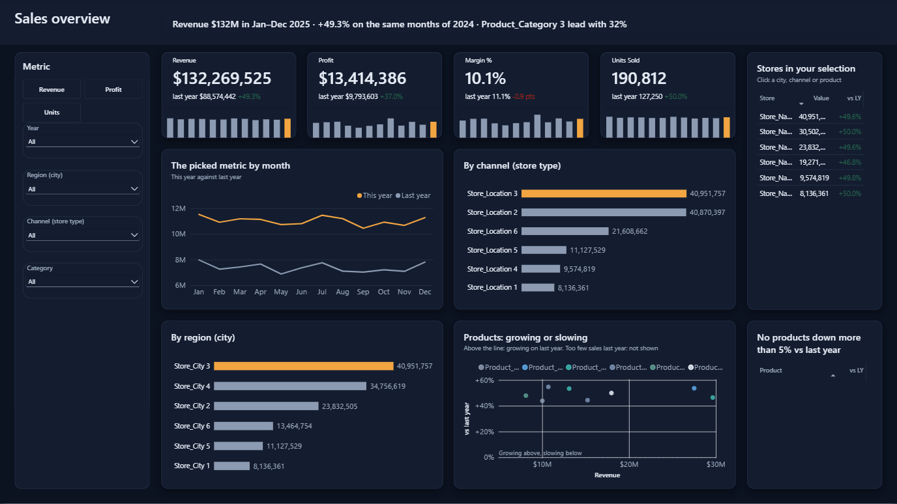
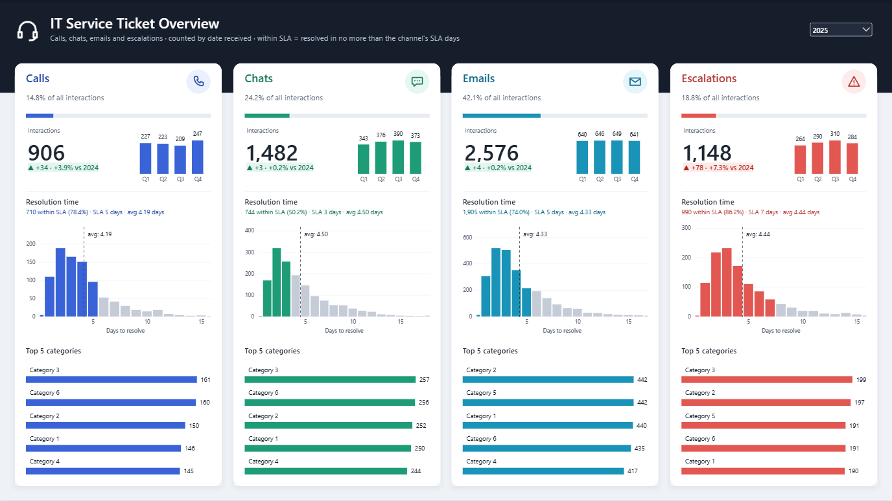
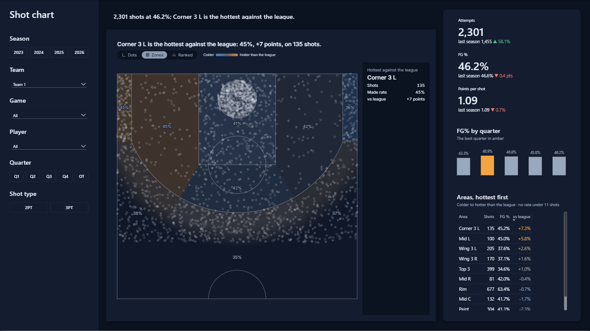
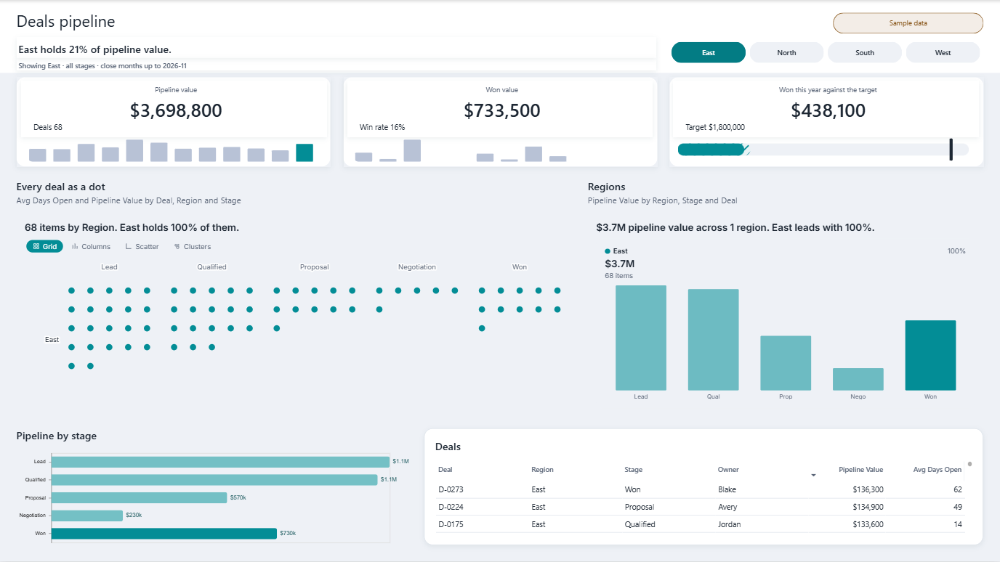

# pbik examples

Finished example reports built with pbip-kit (pbik), each a Power BI project (PBIP) with its made-up data inside
the model. Download the repository as a zip, unzip it, and open the `.pbip` of an example in Power BI Desktop.

| Example | What it shows | |
| --- | --- | --- |
| [Electronic Sales](electronic-sales) | Dark glass: an app-like sales overview on one page |  |
| [IT Service Desk](it-service-desk) | Panel style layout: one panel per channel, threshold histograms, drill-through |  |
| [Shot Chart](shot-chart) | Spatial canvas: a court with Dots, Zones and Ranked views that filter the page |  |
| [App visuals proof](app-visuals-proof) | Kit custom visuals: morphing dots, org chart, 3D sites, map |  |

- **Data:** made-up only, as calculated tables or literal rows in each model: nothing to refresh, no external
  source.
- **Custom visuals:** the kit's own visuals are bundled inside each report (`<Report>/CustomVisuals`); their
  licences (MIT template code; d3 and others ISC, BSD or MIT; Inter font OFL; d3-flextree WTFPL; three.js and flubber MIT;
  us-atlas ISC) are in each example's `LICENSES` folder. They are private visuals, not AppSource-certified.
- **Desktop:** built and checked on Power BI Desktop 2.159.
