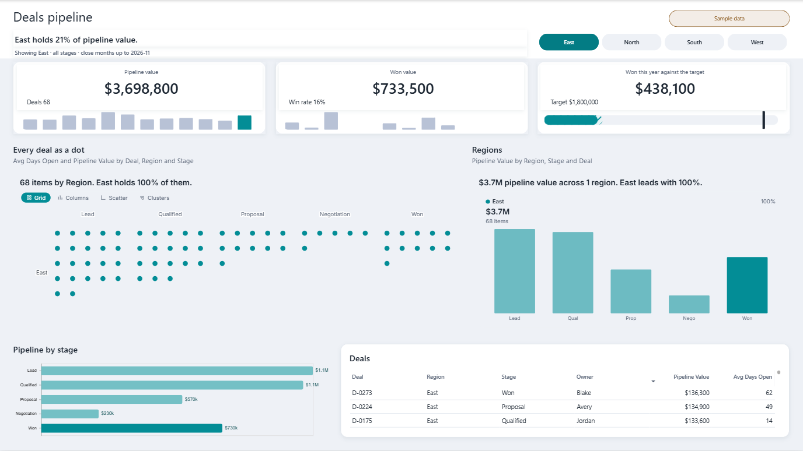
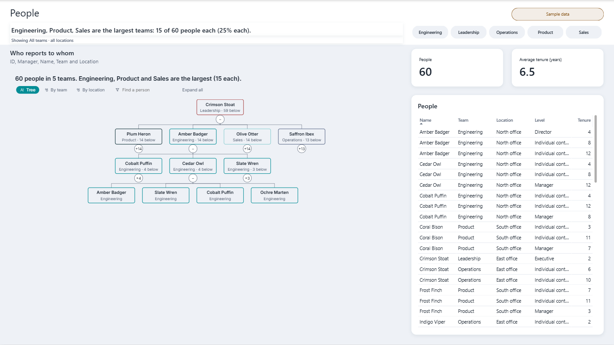
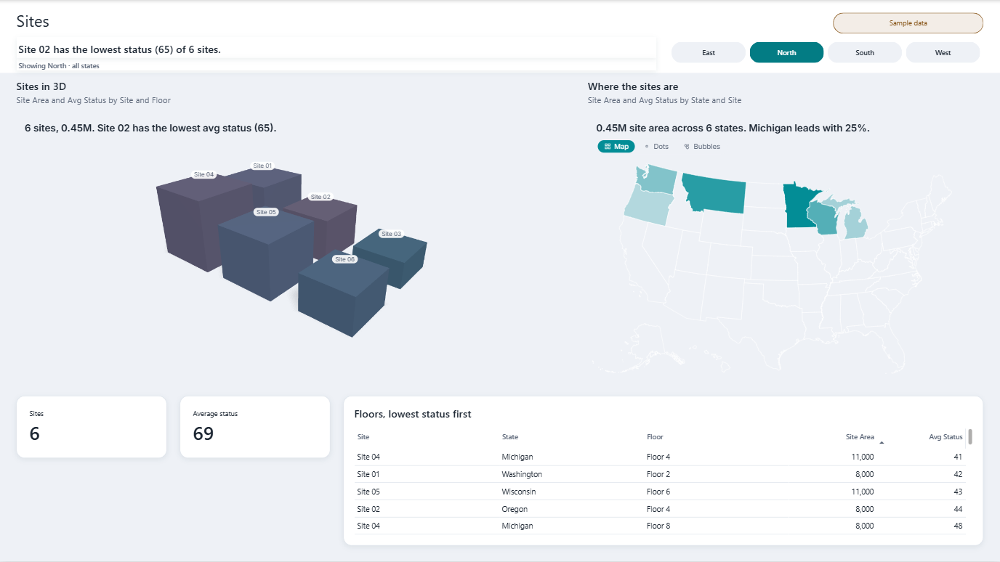

# App visuals proof (Deals app, People, Sites)

| Deals app | People | Sites |
| --- | --- | --- |
|  |  |  |

The kit's proof report for app-like visuals: kit custom visuals that morph between views, filter the page on click
and keep their state in bookmarks.

- **Deals app:** every deal as a dot (Grid, Columns, Scatter, Clusters, morphing between them), the regions panel
  (drill into a region and back), KPI tiles with mini bars and a won-against-target bar, pipeline by stage (a Deneb
  chart), the deals table; region pills at the top.
- **People:** an org chart that expands and collapses, finds a person and regroups by team or location.
- **Sites:** sites as 3D blocks by floor and a US state map (Map, Dots, Bubbles).
- **Kit patterns:** morph layouts, drill-zoom, network and org chart, 3D scene, map, view pills, live headline,
  KPI mini bars, forecast bullet.
- **Build routes:** native visuals, five kit custom visuals (in `Proof.Report/CustomVisuals`, loaded by Desktop with
  the report; private, not AppSource-certified; licence notices and IT hand-off notes in [LICENSES](LICENSES)) and
  Deneb (a certified AppSource visual Desktop downloads on first open: needs AppSource access).
- **Org chart layout:** Format pane > Tree > Tree layout: Compact uses d3-flextree (WTFPL), Standard uses d3.tree
  (ISC) only.
- **Data:** made-up (invented deals, people with made-up two-word names, sites and floors).

## Open it

1. Download the repository as a zip (Code > Download ZIP) and unzip it.
2. Open `Proof.pbip` in Power BI Desktop (2.159 or later was used; File > Open, or double-click it).
3. The data is inside the model (made-up rows as calculated tables): nothing to refresh, no connection to set up.
