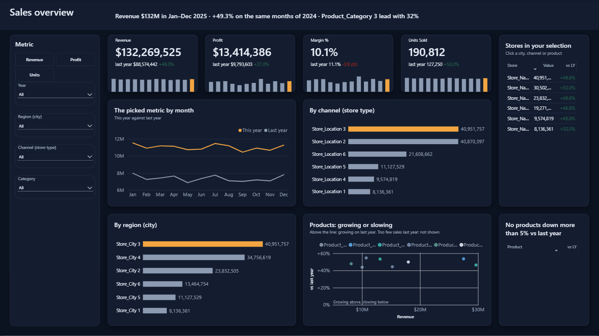

# Electronic Sales (dark glass)

An app-like sales overview for sales managers on one page: where revenue comes from (city and store type stand in
for region and channel), the trend against last year, which products are growing or slowing, and which need
attention. Clicking a city, a store type or a product focuses the rest of the page.

- **Style:** dark glass (preset `dark-glass`): navy base, one warm accent, muted data with one highlight, a rail of
  pickers on the left, panels for the content.
- **Kit patterns:** live headline (the sentence at the top follows the filters), KPI tiles with mini bars (last
  year and the change on each), focus-dim (the picked metric's trend this year against last), direct labels,
  exception list (products down more than 5%), honest data (too few sales last year: not shown).
- **Build route:** native Power BI visuals only.
- **Data:** made-up (invented stores, cities and products).

## Open it

1. Download the repository as a zip (Code > Download ZIP) and unzip it.
2. Open `Electronic Sales.pbip` in Power BI Desktop (2.159 or later was used; File > Open, or double-click it).
3. The data is inside the model (made-up rows as calculated tables): nothing to refresh, no connection to set up.
