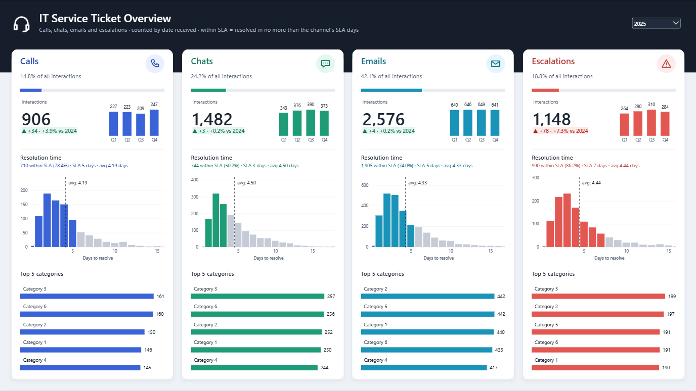

# IT Service Desk (panel style layout)

An operational IT service page for team leads: ticket volume by channel, SLA performance, resolution time and the
categories that take the most tickets, one full-height panel per channel (calls, chats, emails, escalations), with
a year picker in the header band. Right-click a bar in a Top 5 list and drill through to that category's tickets
(page "Category tickets").

- **Style:** panel style layout (preset `panel-style`, built with `pbik layout panels`): a dark header band, white
  panels with one identity colour per channel and a kit-drawn icon.
- **Kit patterns:** per panel: share line and bar, the big number with a change chip against last year, quarterly
  mini columns with compact labels, a threshold histogram (days to resolve, bars past the SLA in grey, the average
  as a dashed line), the top 5 categories with the label above each bar; live headline; drill-through with cards
  that compare like the main page.
- **Build route:** native Power BI visuals only; the icons are images the kit draws.
- **Data:** made-up (invented tickets, channels and categories).

## Open it

1. Download the repository as a zip (Code > Download ZIP) and unzip it.
2. Open `IT Service Desk.pbip` in Power BI Desktop (2.159 or later was used; File > Open, or double-click it).
3. The data is inside the model (made-up rows as calculated tables): nothing to refresh, no connection to set up.
