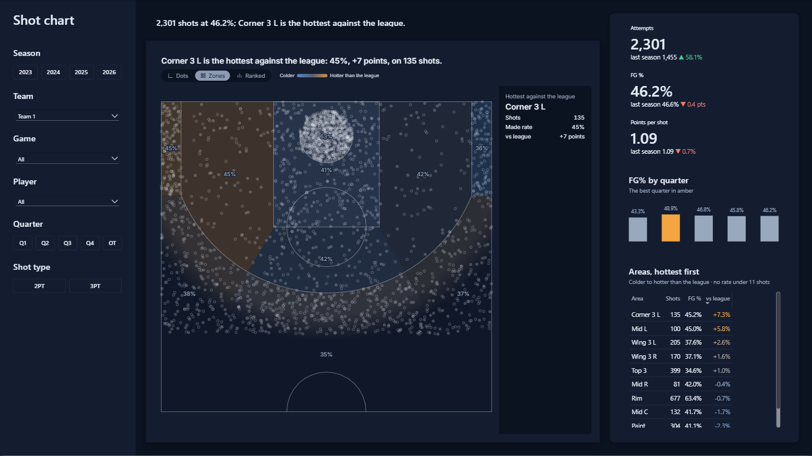

# Shot Chart (spatial canvas: Dots and Zones)

A shot analysis page for coaches: where players shoot from and how well, on a generic half court (no league or
team marks). Areas are coloured colder or hotter than the league's rate for that area, on one scale shared with the
table; Dots shows every shot (made filled, missed hollow); Ranked lines the areas up. Click an area to filter the
page. Pick a player, a game or a quarter: areas with too few shots fade, and under 11 shots no rate is shown.

- **Style:** dark glass with a rail of pickers (season, team, game, player, quarter, shot type) and a docked side
  panel (cards with last season, FG% by quarter, the areas table).
- **Kit patterns:** spatial canvas (a kit custom visual: Dots, Zones and Ranked with a morph between them), honest
  data (small samples), live headline, one accent (the best quarter).
- **Build route:** native visuals plus one kit custom visual (`Shot Chart.Report/CustomVisuals/pbikShotMaped2e57`,
  loaded by Desktop with the report). It is a private visual, not certified on AppSource: its licence notices and IT
  hand-off notes are in [LICENSES](LICENSES).
- **Data:** made-up (invented teams, players and 18,000 shots at realistic rates).

## Open it

1. Download the repository as a zip (Code > Download ZIP) and unzip it.
2. Open `Shot Chart.pbip` in Power BI Desktop (2.159 or later was used; File > Open, or double-click it).
3. The data is inside the model (made-up rows as calculated tables): nothing to refresh, no connection to set up.
